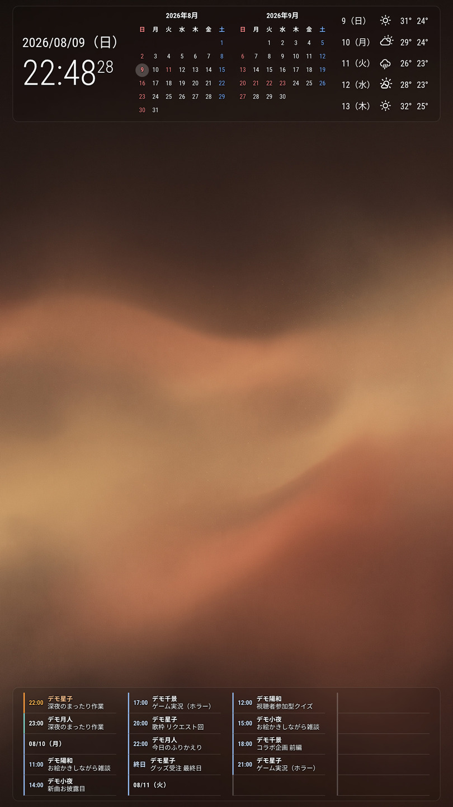
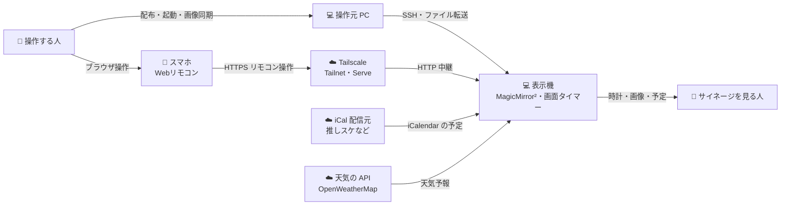

# yp-signage

縦置きの外部モニターに、時計、月間カレンダー、天気、背景スライドショー、推しの配信予定をまとめて表示するサイネージです。
[MagicMirror²](https://github.com/MagicMirrorOrg/MagicMirror) の設定と自作モジュールで構成しています。

このリポジトリにMagicMirror²本体は含まれていません。
先に本体を導入し、設定と自作モジュールを配布して使います。



上の画像は実機（縦 1080×1920）をデモモードで撮影したものです。
背景と予定はすべて同梱のサンプルデータで、デモ起動用の環境変数 `SIGNAGE_DEMO=true` を指定して起動すれば同じ画面が出ます。

使っていないノートPCと外部モニターを活用し、時計やカレンダーと一緒に推しの配信予定を常時表示したい、というところから作り始めました。
配信予定は自作のWebサービスである[推しスケ](https://github.com/YoyogiPinball/oshi-sche-webapp)からiCalendar形式で受け取ります。

## 何ができるか

画面は背景、上部の情報欄、下部の予定欄という3層で構成されています。

| 機能 | できること |
|---|---|
| 背景 | 手元の画像フォルダを再帰的に読み取り、60秒ごとにフェードで切り替えます。表示順と、最後の画像まで進んだあとの動作を選べます |
| 上部 | 時計、今月と来月のカレンダー、5日分の天気予報を表示します。カレンダーには祝日と振替休日も表示します |
| 下部 | iCalendarで購読した今後の予定を、開始時刻のそろった2段のカードで表示します |
| 画面タイマーとリモコン | 曜日ごとの予定に合わせて外部モニターを点灯または消灯し、ブラウザから画面とスライドショーを操作できます |

下バーの予定は、配信開始時刻になるとその枠だけがふわっと点滅します。
画面を覆う通知は出しません。
視界の端に置く画面なので、視線を奪わずに気づける見せ方にしています。

## 全体の構成



配布モードでは、操作元 PC から SSH で表示機へ設定とモジュールを配り、スマホのリモコンは Tailscale Serve を通して接続します。
ローカルモードでは操作元 PC と表示機が同じ機械です。設定とモジュールは SSH を使わずにコピーします。
表示機は iCal 配信元と天気の API から情報を取得し、デモモードでは通信せずサンプルを表示します。

## 使い方を選ぶ

| 項目 | 配布モード | ローカルモード |
|---|---|---|
| 配り方 | 別の PC から SSH で専用の表示機へ配ります | 同じ PC の中でコピーします。配布先を選ぶ環境変数は `SIGNAGE_HOST=local` です |
| 画面の点灯・消灯 | 画面タイマーを有効にすると、GNOME セッション全体の画面を制御します | 既定で無効です。モニター本体の電源ボタンか OS の設定で消してください |
| 画像の置き方 | 操作元の画像フォルダを表示機へ同期します | 表示機の設定ファイル `.env` の画像フォルダ設定 `SIGNAGE_IMAGE_DIR` を使い、同期せず直接表示します |
| 向いている人 | サイネージ専用の PC とモニターを常設したい人 | 作業用 PC の1画面をサイネージに使いたい人 |

画面タイマーを無効にしても、Webリモコンで画像操作と表示履歴を使えます。
有効化の手順と、ローカルモードで点灯・消灯を使う場合の設定は [画面タイマーとリモコン](docs/remote.md) にあります。

## 動作環境

**以下の構成でのみ検証しています。** 横画面やRaspberry Pi 等での動作は未確認です。

共通の環境は次のとおりです。

| 項目 | 検証している構成 |
|---|---|
| OS | Ubuntu 26.04 / GNOME (Wayland) + XWayland |
| Node.js | 24（MagicMirror² v2.37 が要求するバージョンに従う） |
| MagicMirror² | v2.37 を `~/MagicMirror/` に導入済み |

使い方は2通りで、どちらも検証しています。

| 使い方 | 表示機 | モニター | 配り方 |
|---|---|---|---|
| サイネージ専用の PC | ThinkPad X13 Gen1 | 外部モニター1枚を縦置き（1080×1920） | 別の PC（WSL）から ssh で配る |
| 作業用 PC の1画面を使う | MSI GF63 Thin | 内蔵画面・横置きの作業用モニター・縦置きのサイネージ用モニターの3枚 | 同じ PC の中でコピーする（`SIGNAGE_HOST=local`） |

表示するモニター・解像度・表示倍率は `.env` で変えられます。横画面や HiDPI 画面で試す場合も、コードの変更は要りません。

## 導入

> **Note:** これ以降の例では、SSH Host 名を `signage` と決めたものとして書いています。
> 別の名前にした場合は `ssh signage …` の `signage` を読み替えてください。
> `local` の場合は `ssh signage '…'` を外し、引用符の中のコマンドをそのまま実行してください。
> `./deploy.sh` と `./sync-images.sh` は、リポジトリ直下の配布・同期用設定ファイル `signage.conf` を読むので、読み替えは不要です。
> ただし `./sync-images.sh` はローカルモードに対応していません。[画像の配置と同期](docs/images.md) を参照してください。

### 1. MagicMirror² 本体を入れる

[本家の手順](https://docs.magicmirror.builders/getting-started/installation.html) に従って
表示機の `~/MagicMirror/` に導入し、初期状態で画面が出るところまで先に確認してください。
本体が動かないうちに設定を追加すると、問題の切り分けが難しくなります。

### 2. このリポジトリを取得する

配布モード: 操作元の PC に clone します。

ローカルモード: 表示機として使う作業用 PC に clone してください。

```bash
git clone https://github.com/YoyogiPinball/yp-signage.git
cd yp-signage
```

### 3. 配布先を決める

`deploy.sh` は設定・モジュールを配布するスクリプト、`sync-images.sh` は画像を同期するスクリプトです。
どちらもリポジトリ直下にあり、配布先を `signage.conf` から読み取ります。
このファイルは `.gitignore` で除外されるため、ホスト名や手元のフォルダ構成がリポジトリに入らないようになっています。

```bash
cp signage.conf.example signage.conf
$EDITOR signage.conf     # SIGNAGE_HOST_DEFAULT に ssh の設定名を書く
```

配布モード: SSH の接続先設定ファイル `~/.ssh/config` の `Host` 名を書いてください。鍵認証で接続できるようにしておく必要があります。
配布先をその場限りで変えたいときは `SIGNAGE_HOST=別の名前 ./deploy.sh` でも指定できます（こちらが優先されます）。

ローカルモード: ssh の設定名の代わりに `SIGNAGE_HOST_DEFAULT="local"` と書きます。
`deploy.sh` は ssh を使わず、同じ PC の中でコピーします。

### 4. まず動かしてみる（デモモード）

自分の画像も iCal も用意しないまま、完成した画面を先に確認できます。**通信は一切しません。**

手順 7〜8（配る → 権限修正）まで進めたら、次のコマンドで起動します。

```bash
ssh signage 'SIGNAGE_DEMO=true bash ~/run/mm-start.sh'
```

背景には同梱のサンプル画像、配信予定にはダミーデータが表示され、天気は API キー不要のデモ用パネルに
差し替わります。「入れたのに何も出ない」と困る前に、動いている状態を見ておくためのものです。
デモモードになるのはこの起動の回だけで、`SIGNAGE_DEMO=true` を付けずに起動し直せば元の画面に戻ります。

### 5. 背景画像を置く

配布モード: 表示機の `~/signage/slides/` に画像を置きます。
最初は同梱のサンプル画像を使えます。

ローカルモード: `.env` の `SIGNAGE_IMAGE_DIR` に画像フォルダの絶対パスを書き、そのフォルダを直接表示します。
画像同期は不要です。デモモードでは、どちらのモードでも自分の画像を用意する必要はありません。

コピーするコマンドと同期方法は [背景画像の配置と同期](docs/images.md) にあります。

### 6. .env を書く

`.env` は、iCal URL・API キーと表示機ごとの設定を保存するファイルです。
表示機の `~/MagicMirror/.env` に置きます。`config/` の中には置かないでください。

配布モード: 表示機に SSH で接続して編集します。

ローカルモード: 同じ PC の `~/MagicMirror/.env` を直接編集してください。

既存の `.env` は配布時に上書きされず、ファイルが無いときだけひな形が置かれます。
初回の配置コマンド、書式、モニター選択、倍率、機能のオン・オフは [表示と機能の設定](docs/configuration.md) を参照してください。

### 7. サイネージ用端末へ配布する

```bash
./deploy.sh
```

配布先は手順 3 で `signage.conf` に指定した機械です。別の機械へ 1 回だけ配りたいときは
`SIGNAGE_HOST=別の名前 ./deploy.sh` としてください。何をどこへ置くかは [配布先の対応表](docs/architecture.md#配布先の対応表) にあります。

### 8. 初回だけ必要な権限修正

```bash
ssh signage 'sudo bash ~/run/mm-fix-sandbox.sh'
```

Electron は `chrome-sandbox` の所有者と権限が特定の状態でないと起動を拒否します。
パッケージの入れ方によっては条件を満たしていないため、初回に一度だけ修正が必要です。

### 9. 起動する

配布モードでは先に表示機で `loginctl enable-linger <ユーザー名>` を実行し、SSH を切ってもユーザーサービスを動かし続ける設定にしてください。
起動には次のコマンドを使います。

```bash
ssh signage 'bash ~/run/mm-start.sh'
```

停止、ログの確認、右クリックメニューと操作コマンドは [起動と日々の操作](docs/operation.md) にあります。
ブラウザから操作する場合は [画面タイマーとリモコン](docs/remote.md) を参照してください。

## 詳しい資料

| ファイル | 何が書いてあるか |
|---|---|
| [docs/configuration.md](docs/configuration.md) | `.env` の置き場所と書式、表示倍率、モニター選択、機能のオン・オフ |
| [docs/operation.md](docs/operation.md) | 起動・停止・ログ、右クリックメニュー、操作コマンド、画面撮影 |
| [docs/remote.md](docs/remote.md) | 画面タイマー、Webリモコン、点灯予定、Tailscale Serve、SSH での点灯 |
| [docs/images.md](docs/images.md) | 背景画像の配置、ローカルモードの画像指定、配布モードの同期と記録、自動実行 |
| [docs/architecture.md](docs/architecture.md) | 表示機内の構成図、自作モジュール、CSS、配布先の対応表、配布しないもの |

## 更新するとき

すでに動かしているものを更新する場合は、先に [CHANGELOG.md](./CHANGELOG.md) を読んでください。
変更内容と、`.env` の書き換えが要るかどうかを書いてあります。

## 作者

代々木ピンボール（YoyogiPinball）。現在求職中です。

- [ポートフォリオ](https://yoyogipinball.github.io/)
- [X（@Yoyogi_Pinball）](https://x.com/Yoyogi_Pinball)

## ライセンスと免責

MIT ライセンスです。改変・再配布・商用利用のいずれも自由です。

無保証で、**サポートは行いません**。Issue や Pull Request を開いていただいても対応できません。
そのうえで役に立ちそうであれば、遠慮なくお使いください。

MagicMirror² 本体（MIT）に依存しています。本体はこのリポジトリには含まれていません。
