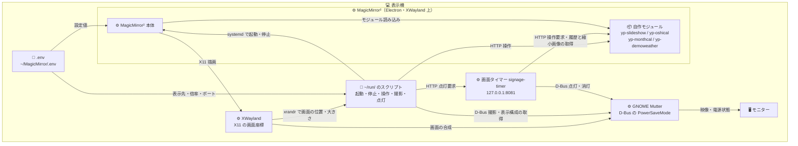

# 表示機の構成と配布先

表示機では MagicMirror² が画面を描き、画面タイマーが GNOME に点灯・消灯を依頼します。
自作モジュールの役割と、リポジトリの各ファイルが配布される場所を確認できます。

[概要へ戻る](../README.md)

## 表示機の中の部品

MagicMirror² は XWayland 上の Electron で動きます。背景・予定・月カレンダー・デモ天気を担当するのは自作モジュールです。
起動スクリプトは xrandr から画面の位置と大きさを取得し、画面タイマーは D-Bus の PowerSaveMode で GNOME セッション全体の点灯・消灯を切り替えます。
リモコンで画像操作・履歴の確認・縮小画像の取得を行うと、画面タイマーが MagicMirror² へ HTTP で問い合わせます。

表示機の `.env` は `~/MagicMirror/.env` に置く設定ファイル、`~/run/` は操作スクリプトの配布先です。
画面タイマーのポートと画面制御は [リモコンの設定](remote.md#画面タイマーを有効にする)、表示先と倍率は [表示の設定](configuration.md) で変更できます。

## 自作モジュール

### yp-slideshow（背景スライドショー）

`yp-slideshow` は `magicmirror/modules/yp-slideshow/` にある背景表示用モジュールです。
`position: "fullscreen_below"` で画面全体に画像を敷きます。node_helper が画像フォルダを再帰スキャンし、
Express の静的ルート `/yp-slideshow/images` で配信します。フォルダを増やしても設定変更は不要です。

対応する拡張子は次のとおりです。`.` で始まるフォルダは対象外です
（同期ツールの管理フォルダをスキャン対象に含めないようにするため）。

| 画像形式 | 拡張子 |
|---|---|
| JPEG | `.jpg` / `.jpeg` |
| PNG | `.png` |
| GIF | `.gif` |
| WebP | `.webp` |
| BMP | `.bmp` |

表示の仕方は `.env` の2つの設定で決まります。
`SIGNAGE_ORDER_MODE` が並べ方を、`SIGNAGE_REPEAT_MODE` が最後の画像まで来たときの動きを決めます。

| 設定キー | 値 | 動作 |
|---|---|---|
| `SIGNAGE_ORDER_MODE` | `sequential` | ファイル名の自然順で、`2.jpg` が `10.jpg` より先です |
| `SIGNAGE_ORDER_MODE` | `shuffle` | 順番を混ぜます |
| `SIGNAGE_REPEAT_MODE` | `all` | 先頭へ戻ります |
| `SIGNAGE_REPEAT_MODE` | `none` | 最後の画像で止まります |
| `SIGNAGE_REPEAT_MODE` | `one` | 1枚を表示し続けます |

並び順・現在位置・再生状態を扱う部分は同モジュール内の再生状態管理ファイル `playback.js` に分けてあり、画面を起動せずに
`node --test tests/` で検証できます（Node 20 以降に標準で入っているテスト機能を使うので、
`npm install` は要りません）。テストは操作元のマシンで実行し、表示機には配りません。

> **Note:** 画像一覧は 10 分ごとに取り直しますが、そのときシャッフル順を作り直しません。
> 現在位置は「並びの何枚目か」として保持しているため、並びが変わると同じ位置が別の画像を指し、
> 「前へ」がさっき見た画像に戻らなくなります。増えた画像は既存の並びへ差し込むだけにしてあります。

このモジュールには外部から操作するための HTTP エンドポイントがあります。`~/run/` の操作スクリプト `mm-ctl.sh` はこれを呼び出しています。
MagicMirror の `ipWhitelist` の内側にあり、外部からはアクセスできません。

### yp-oshical（予定バー）

iCal (ICS) フィードを 5 分ごとに取得し、今から先の予定を 2 段カードで並べます。
外部ライブラリは使わず、ICS を自前でパースしています（行の折り返しを戻して VEVENT を走査するだけで済みます）。

枠は「列数 × 5 行」で固定です。今日の予定を上から詰め、枠が余ったら明日、それでも余ったら明後日と、
枠が埋まるまで先へ進みます。予定が立て込む日は今日だけで埋まり、予定が少ない夜は数日先まで表示します。
**何日先まで出すかを決めない**のは、画面の大きさのほうが先に決まっているためです。

| 表示の決まり | 内容と理由 |
|---|---|
| 日付セル | 今日以外の日は予定の先頭に「07/28（火）」を1枠挟みます。列は送らず、時刻の流れの中に置きます |
| 色は2色 | 今日の予定と翌日以降の予定で色を分けます。日ごとに色を増やすと、配信中を示すオレンジが埋もれます |
| 枠は常に引く | 予定が少なくても枠ぶんの区切り線を薄く出します。件数で帯の高さや列幅が変わると、同じ場所でも日によって違う表示に見えてしまうためです |

予定が 1 件も無いとき、既定ではバー全体を非表示にして背景画像だけにします（`hideIfEmpty`）。
`false` にすると「この先の予定なし」と書いた枠を 1 つ表示します。**どちらが良いかは運用次第です。**
バーを非表示にすると画面の情報は減りますが、「モジュールが落ちた」のか「予定が無い」のかを画面から区別できなくなります。

#### 推しスケ（oshi-sche-webapp）との連携

作者は [推しスケ](https://github.com/YoyogiPinball/oshi-sche-webapp) が発行する ICS フィードに接続して使っています。
推しスケは、VTuber やアイドルの配信スケジュール画像を AI が読み取り、iCal 購読 URL を発行する Web アプリです。

推しスケの ICS フィードでは、`SUMMARY` が `【名前】タイトル` の形式（例: `【〇〇さん】雑談配信`）で出力されます。
yp-oshical はこの形式を検知すると、名前とタイトルを 2 段に分けてカードに表示します。
この形式でない `SUMMARY` はそのまま 1 段で表示するため、Google カレンダーの「限定公開 URL（iCal 形式）」など、
ICS を配信できるサービスであれば何でも接続できます。

`.env` の `SIGNAGE_CALENDAR_ICS` に ICS の購読 URL を設定してください。

### yp-monthcal（月カレンダー）

今月と来月のグリッドを横に並べて表示します。今日の日付には丸を付けます（来月には付きません）。
予定は載せません（予定の表示は下バーの役割です）。土曜は青、日曜と祝日は赤です。
祝日の判定は外部ライブラリに依存しない自前実装で、固定祝日・ハッピーマンデー・春分秋分・振替休日・国民の休日に対応しています。

### yp-demoweather（デモ用の天気パネル）

デモ起動用の環境変数 `SIGNAGE_DEMO=true` のときだけ、組み込みの天気モジュールの代わりに表示されます。
通信せず、固定の 5 日予報を描くだけの 100 行ほどのモジュールです。

## custom.css の考え方

`custom.css` は `magicmirror/css/` にある表示用スタイルで、表示機では `~/MagicMirror/css/custom.css` に置きます。
背景がスライドショー画像なので、その上に載る文字をどう読みやすくするかが要点です。

| 対象 | 表示の方針 |
|---|---|
| 余白 | 画面端の余白を詰めて、パネルを画面の角へ寄せています |
| 文字 | `text-shadow` でソフトな黒フチを付けています |
| プレート | `.r5-plate` クラスで背景をぼかし（`backdrop-filter: blur(3px)`）、薄い黒の半透明プレートを敷いています |
| プレート内の文字色 | 白で統一しています（MagicMirror 既定の灰色階調を上書き） |
| 背景画像 | 画像そのものには影を付けていません |

## 配布先の対応表

リポジトリ直下の配布スクリプト `deploy.sh` は次のとおりファイルを配置します。手でコピーする場合もこの表に従ってください。

| リポジトリ側 | 表示機側 |
|---|---|
| `scripts/`（`*.sh` と `mm-shot.py` / `mm-shot.js` / `README.md`） | `~/run/` |
| `magicmirror/config.js` | `~/MagicMirror/config/config.js` |
| `magicmirror/.env.example` | `~/MagicMirror/.env`（`config/` ではなくルート）。表示機に `.env` が無いときだけ置き、既にあれば上書きしない |
| `magicmirror/css/custom.css` | `~/MagicMirror/css/custom.css` |
| `magicmirror/modules/yp-*/` | `~/MagicMirror/modules/yp-*/` |
| `samples/` | `~/MagicMirror/samples/`（デモモードが参照する背景画像） |
| `scripts/signage-timer/` | `~/run/signage-timer/`（画面タイマーとリモコンの本体） |
| `host/systemd/signage-timer.service` | `~/.config/systemd/user/signage-timer.service`（画面タイマーを常駐させるユーザーサービス） |
| なし（`deploy.sh` が書き出す） | `~/.config/systemd/user/signage-timer.service.d/local.conf`。ローカルモードのときだけ置き、画面の点灯・消灯の制御を既定で無効にする。配布モードで配るとこのファイルを消す |

### 配布しないもの

| 配布しないもの | リポジトリ内での役割 |
|---|---|
| `legacy/` | 記録用です |
| `host/monitors.xml` | 記録用です |
| `tests/` | 手元で `node --test tests/` を実行するためのもので、表示機では使いません |
