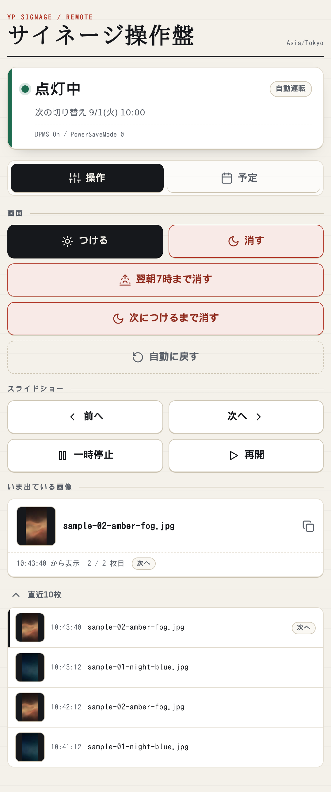
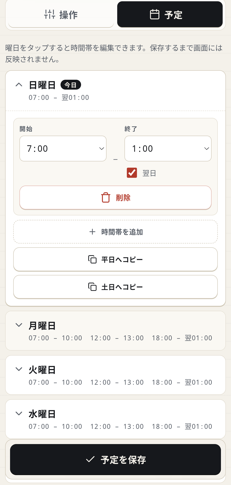

# 画面タイマーとリモコン

画面タイマーは曜日ごとに設定した時間帯だけ外部モニターへ映像を出します。
消灯中もMagicMirror²は動き続けるため、点灯するとすぐ元の画面へ戻ります。

[導入の手順へ戻る](../README.md#導入)

Webリモコンでは画面とスライドショーの操作に加え、曜日ごとの点灯予定も編集できます。

<p align="center">
  
  
</p>

左が操作画面、右が点灯予定の編集画面です。
スマートフォンから片手で操作できるよう、縦長の画面にまとめています。

| 操作 | できること |
|---|---|
| 点灯・消灯 | 画面を点灯または消灯します |
| 期限付きの消灯 | 次の自動切り替えまで、または翌朝7時まで消灯します |
| 次につけるまで消す | リモコンかSSHから点灯するまで消灯を維持します |
| 自動運転へ戻す | 手動操作を取り消します |
| スライドショー | 一時停止・再開と、前後の画像への移動ができます |
| 表示履歴 | いま出ている画像のファイル名と直近10枚の履歴を確認し、縮小画像をタップして拡大できます |
| 点灯予定 | 曜日ごとの点灯予定を編集できます |

「いま出ている画像」には表示中のファイル名と、その画像が全体で何枚目かを表示します。
ファイル名をタップするとクリップボードへコピーするので、サイネージを見ていて気になった1枚のファイル名を、打ち直さずに手元へコピーできます。

左の縮小画像をタップすると、拡大して表示します。
拡大したまま、ファイル名をタップしてコピーもできます。

「直近10枚」を開くと、切り替わった時刻と、切り替わった理由（次へ・前へ・代替・壊れ）まで並びます。
表示機の `.env` は `~/MagicMirror/.env` に置く MagicMirror² の設定ファイルです。
同じ履歴は表示機の `~/signage/r5-now.log` にも書き出されます（書き出し先は `.env` の `SIGNAGE_LOG_PATH` で変えられます）。
履歴はMagicMirror²のメモリ上にあるため、再起動すると消えます。

縮小画像は、MagicMirror²が画像を表示した瞬間にブラウザ側で作り、履歴と一緒にメモリに保存します。
元の画像ファイルをリモコンから配信することはないため、拡大しても長辺1080pxまでです。
リモコンは画像のファイル名を受け取ってディスクを読みに行くのではなく、直近10枚として実際に画面へ出した縮小画像の中からだけ返します。

## 画面タイマーを有効にする

既定の点灯予定は次のとおりです。
`25:00`は、翌日の午前1時を表します。

| 曜日 | 点灯する時間帯 |
|---|---|
| 平日（月〜金） | 07:00〜10:00 / 12:00〜13:00 / 18:00〜25:00 |
| 土日 | 07:00〜25:00 |

リポジトリの配布スクリプト `deploy.sh` で配布しただけでは、画面タイマーは起動しません。
初回だけ、表示機で次のコマンドを実行してユーザーサービスを有効にします。

```bash
systemctl --user enable --now signage-timer
```

設定を変える場合は、表示機の `~/.config/yp-signage/timer.env` に `KEY=値` の形で書きます。
このファイルがなくても、既定値で動作します。

| キー | 効果 |
|---|---|
| `SIGNAGE_TIMER_USER` | 操作を許可する Tailscale のログイン名。設定すると、Tailscale Serve を通った同じログイン名の要求だけを受け付けます |
| `SIGNAGE_TIMER_PORT` | リモコンの待受ポート。既定は `8081` です |
| `SIGNAGE_TIMER_TZ` | 点灯予定の判定に使う IANA タイムゾーン名。既定は `Asia/Tokyo` です |
| `SIGNAGE_DISPLAY_CONTROL` | `false`にすると点灯・消灯と自動消灯を無効にし、画像操作と履歴だけを使えます。既定は`true`です |

書き換えた設定は `systemctl --user restart signage-timer` でサービスを再起動すると反映されます。

### ローカルモードでの既定

> **Note:** リモコンの「画面を消す」は、作業中のモニターも含めて全部の画面を消します。
> そのため `SIGNAGE_HOST=local` で配ると、画面の点灯・消灯の制御は既定で無効になります。
> サイネージ用のモニターは、モニター本体の電源ボタンか OS の設定で消してください。

画面制御が有効な場合、点灯・消灯はGNOMEセッション全体に作用し、作業中のモニターも対象になります。
そのため`SIGNAGE_HOST=local`で配布すると、`deploy.sh`が`SIGNAGE_DISPLAY_CONTROL=false`を既定にします。
`timer.env`に`SIGNAGE_DISPLAY_CONTROL=true`と書けば、その値が優先です。
配布モードで使う作業用PCの別モニターへ表示する場合は、`timer.env`へ`SIGNAGE_DISPLAY_CONTROL=false`を書いてください。
無効な場合は画面制御・点灯予定の操作を表示せず、APIへの直接操作も拒否します。サービスの開始・終了時も画面の電源状態を変更しません。

## 表示機の外からリモコンを開く

`SIGNAGE_TIMER_USER`を設定していない状態では、表示機のブラウザで`http://127.0.0.1:8081`を開くとリモコンを使えます。
表示機の外からスマートフォンや別のPCで開く場合は、Tailscale Serveを使います。

表示機と操作する端末を同じTailnetへ接続し、次の手順で設定します。

まず、`timer.env`の`SIGNAGE_TIMER_USER`へ、自分のTailscaleログイン名を書きます。
この値を設定せずにTailscale Serveで公開した場合、同じTailnetへ参加している人全員が操作できる状態です。
設定後は、表示機自身のブラウザから開く場合もTailscale ServeのURLを使います。
ログイン名は次のコマンドで確認できます。

```bash
tailscale status --json | grep -o '"LoginName": *"[^"]*"'
```

`--json`を付けない`tailscale status`でも確認できますが、表示幅によってはログイン名の末尾が切れます。
たとえば`you@github`が`you@`に見えることがあり、そのまま転記すると本人確認に失敗します。
設定を反映するには `systemctl --user restart signage-timer` で再起動してください。

次に、Tailnet側でServeを有効にします。
まだ有効になっていない場合、`tailscale serve`は`Serve is not enabled on your tailnet.`というメッセージと管理画面のURLを表示します。
そのURLをブラウザで開き、Serveを有効にしてください。

最後に、表示機で Serve を起動します。

```bash
sudo tailscale serve --bg --https=443 http://127.0.0.1:8081
```

Tailscaleの操作ユーザーを設定していない場合は、`sudo`が必要です。
先に`sudo tailscale set --operator=$USER`を一度実行しておけば、以後の操作では`sudo`を省けます。

`SIGNAGE_TIMER_PORT`を変更した場合は、URLとコマンド末尾の`8081`も同じポートへ変更します。

## SSHから画面を点灯する

「次につけるまで消す」を選ぶと、点灯予定の時刻になっても画面は消えたままです。
モニター本体の電源操作でもこの消灯状態は解除されません。
リモコンの「つける」を押すか、SSHから次のコマンドを実行すると点灯します。

`signage-display-on.sh` は `~/run/` に配布される点灯要求用スクリプトです。
SSH Host 名が `signage` の場合は次を実行してください。

```bash
ssh signage 'bash ~/run/signage-display-on.sh'
```

SSH Host 名を一般化した書式は次のとおりです。`<表示機>` に指定した Host 名を当てはめます。

```bash
ssh <表示機> 'bash ~/run/signage-display-on.sh'
```

このスクリプトは表示機上の`127.0.0.1`からリモコンと同じAPIを呼びます。
Tailscale Serveを経由しないため、Webリモコンを開けないときの復帰手段としても使えます。

点灯予定の編集画面では、日をまたぐ `25:00` を終了時刻の `01:00` と「翌日」のチェックに分けて入力します。
ブラウザの時刻入力欄が `25:00` を扱えないためです。

## 画面制御の仕組みと制限

画面の点灯と消灯には、GNOMEのMutterが提供するD-Busプロパティ`PowerSaveMode`を使います。
Waylandでは画面出力をコンポジタが管理するため、`xrandr`から実画面を制御できません。

サービスは30秒ごとに実際の`PowerSaveMode`を読み、予定または手動操作と異なる場合だけ設定し直します。
`systemctl --user stop signage-timer`などでサービスを止める場合は、画面を点灯してから終了します。

動かないときは、表示機で `systemctl --user status signage-timer` を実行してサービスの状態を確認し、
`journalctl --user -u signage-timer -f` で起動エラーや `PowerSaveMode` の読み書きエラーを確認してください。

点灯予定は曜日だけで判定し、祝日かどうかは判定しません。
夏時間のあるタイムゾーンでは、時計が進んだり戻ったりしたことによる点灯状態の変化を検知できない場合があります。
日本では夏時間がないため、この制限は影響しません。

画面タイマー、Webリモコン、ユーザーサービス、SSH復帰スクリプトは、この公開リポジトリに含まれています。
`deploy.sh signage`を実行すると、これらも表示機へ配布します。
Tailscaleが必要なのは、別の端末からWebリモコンを開く場合だけです。
ログイン名などの環境固有値はリポジトリへ入れず、表示機の`timer.env`へ保存します。

画面制御をGNOMEのMutterへ依頼しているため、ほかのデスクトップ環境やWindowsではそのまま動きません。
